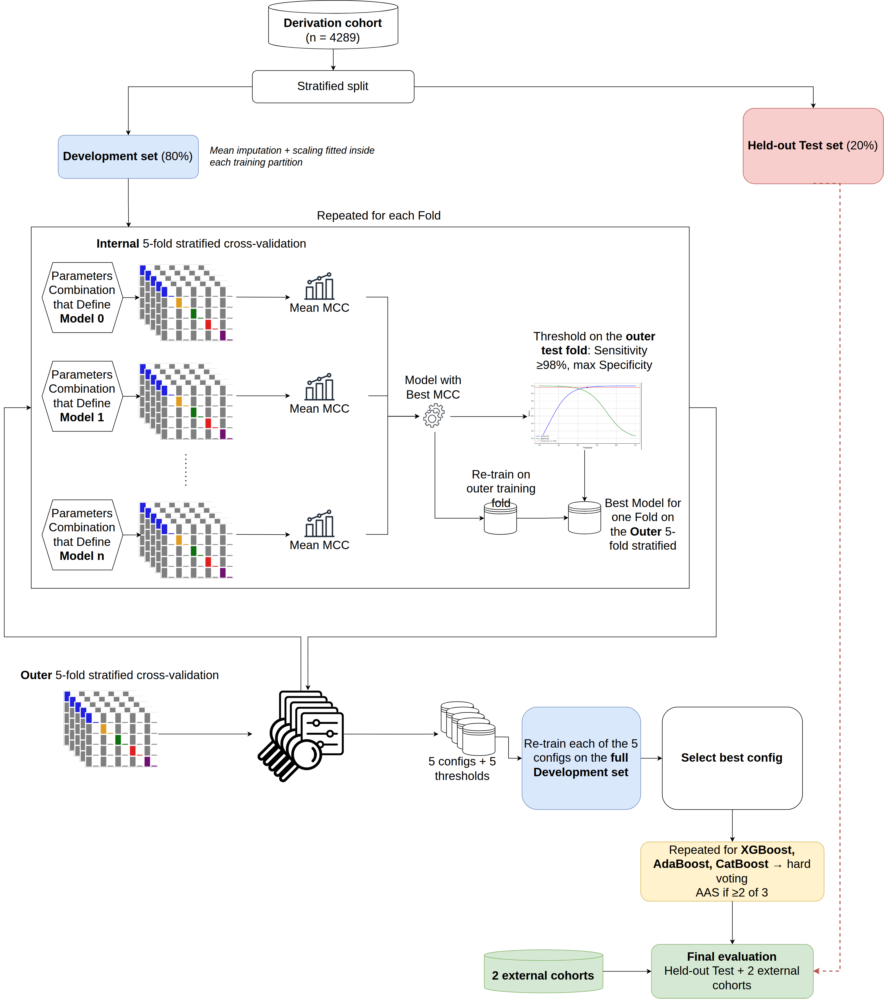

# MELA — Machine-learning tool for acute aortic syndromes

Code and locked models of **MELA**, a machine-learning tool to rule out acute aortic syndromes
(AAS) in the Emergency Department, from the manuscript

> *Development and validation of a machine learning tool for diagnosis of acute aortic
> syndromes in the Emergency Department* — Bima P., Sartori F., *et al.* (under review)

MELA combines **XGBoost, AdaBoost and CatBoost** by hard voting. Each model votes positive when
its probability reaches its locked threshold (sensitivity ≥ 98%, maximum specificity).

| MELA class | positive votes | recommendation |
|---|---|---|
| **I** — rule-out | 0 or 1 of 3 | AAS unlikely |
| **II** — rule-in | 2 or 3 of 3 | CTA |

Online calculator: <https://compbiomed.hpc4ai.unito.it/MELA/>

> **Research code.** MELA is not a certified medical device and must not be used to make
> clinical decisions.



---

## Repository

```
analysis/MELA_analysis.ipynb    development and validation (writes models/ and results/)
analysis/MELA_inference.ipynb   scores a file of patients -> CSV with IDs and predictions
analysis/*_executed.ipynb, *.html   the same notebooks with outputs
models/                         locked pipelines, imputer, scaler, manifest.json
results/locked/                 hyperparameters, thresholds, metrics with 95% CI
toy_data/                       synthetic cohort (200 invented patients)
figures/                        pipeline diagram, SHAP summaries, performance plots

data/                           patient-level cohorts       (git-ignored, not shared)
results/predictions/            per-patient predictions     (git-ignored, not shared)
```

---

## Installation

Python 3.12 with the pinned versions in `requirements.txt` (the hyperparameter search is
sensitive to library versions):

```bash
git clone https://github.com/compbiomed-unito/MELA.git
cd MELA
python -m venv .venv && source .venv/bin/activate
pip install -r requirements.txt
```

---

## Inference

Open `analysis/MELA_inference.ipynb`, set `DATA_PATH` to a `.csv`, `.xlsx` or `.ods` file and
`OUTPUT_PATH` to the output CSV, and run all cells. It runs as is on `toy_data/toy_cohort.csv`.

**Input:** one row per patient with the 28 variables below (names as in
`models/manifest.json`), an optional ID column (`patient_id`, `record_id` or `Uniq_ID`) and an
optional label `final_dgn`. D-dimer is given in ng/mL and log2-transformed by the notebook;
`post_chestpain`, `abd_pain`, `lumb_pain`, `syncope` are set to 0 when missing; any other missing
value is mean-imputed inside the pipeline.

**Output:** one row per patient, indexed by its ID, with `proba_<MODEL>`, `pred_<MODEL>`,
`n_positive_votes`, `prediction` (1 = rule-in) and `MELA_class`. With a label, the notebook also
reports sensitivity and specificity with exact 95% CIs and adds `final_dgn` and `outcome`
(TP / FN / TN / FP).

<details>
<summary><b>Input variables (28)</b></summary>

| variable | description |
|---|---|
| `age` | years |
| `gender` | sex |
| `sympt_time` | hours from symptom onset |
| `ddimer_value` | D-dimer, ng/mL |
| `ant_chestpain` | anterior chest pain |
| `post_chestpain` | posterior chest / back pain |
| `abd_pain` | abdominal pain |
| `lumb_pain` | lumbar pain |
| `sev_pain` | severe pain |
| `sud_pain` | sudden-onset pain |
| `rip_pain` | ripping / tearing pain |
| `ed_pain` | pain present in the ED |
| `syncope` | syncope |
| `pulse` | pulse deficit |
| `focal_neuro_def` | focal neurological deficit |
| `murmur` | new aortic regurgitation murmur |
| `hyper` | hypertension |
| `diab` | diabetes mellitus |
| `smoke` | active smoking |
| `drug` | drug abuse |
| `cad` | coronary artery disease |
| `cancer` | active cancer |
| `marfan` | collagenopathy |
| `family` | family history of thoracic aortic aneurysm or AAS |
| `aort_valve` | aortic valve disease |
| `aort_manip` | previous aortic manipulation |
| `taa` | thoracic aortic aneurysm |
| `aaa` | abdominal aortic aneurysm |

Binary variables are coded 0/1.

</details>

---

## Reproducing the analysis

1. Place the cohorts in `data/` with the file names set in section 1 of `MELA_analysis.ipynb`.
2. *(optional)* TabPFN, an exploratory model outside the ensemble, needs a licence token. Set it
   in the shell, never in a notebook: `export TABPFN_TOKEN="..."`. Without it TabPFN is skipped.
3. Run:

   ```bash
   cd analysis
   jupyter nbconvert --to notebook --execute MELA_analysis.ipynb --output MELA_analysis_executed.ipynb
   ```

This rewrites `models/`, `results/locked/` and `results/predictions/`. Everything is seeded
(`RANDOM_STATE = 42`), so with the pinned versions the results are identical.

In short: the derivation cohort is split 80/20 (stratified) into development and held-out test
sets; on development, an outer 5-fold CV wraps an inner 5-fold grid search (MCC); each outer
fold gives a candidate configuration and threshold; the selected model and threshold are locked
and evaluated once on the held-out test and on the external validation cohort. Imputation and
scaling are fitted inside each training partition. LightGBM, Logistic Regression, Random Forest
and TabPFN go through the same procedure but never enter the vote; the TabPFN pipeline stores
its training patients and is therefore written to `results/predictions/`.

---

## Data

**Patient-level data are not part of this repository and cannot be shared** (study protocols
and ethics approval; see the manuscript's Data Availability statement). `data/` and
`results/predictions/` are git-ignored: never force-add them.

`toy_data/toy_cohort.csv` holds **200 synthetic patients** generated by
`toy_data/make_toy_cohort.py` from published marginal rates. It only lets the notebooks run:
performance measured on it is meaningless.

---

## License

[MIT](LICENSE)
